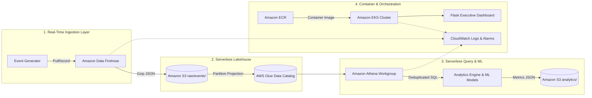

# ☁️ AWS Customer 360 Lakehouse & Real-Time Anal ytics Platform

[](https://aws.amazon.com/)
[](https://www.terraform.io/)
[-326CE5?logo=kubernetes)](https://kubernetes.io/)
[](https://aws.amazon.com/cloudwatch/)
[](https://www.python.org/)
[](LICENSE)

---

## 📌 Project Description

An enterprise-grade, cloud-native **Customer 360 Analytics Lakehouse** deployed on **Amazon Web Services (AWS)** and automated via **Terraform Infrastructure as Code (IaC)**. 

The platform simulates high-throughput real-time e-commerce user interaction events (logins, product views, cart additions, purchases), streams them through **Amazon Data Firehose** into partitioned **Amazon S3** object storage, builds a serverless query catalog with **AWS Glue & Amazon Athena**, trains predictive **Machine Learning models** (Random Forest Churn Prediction & K-Means RFM Segmentation), and serves real-time insights through an interactive **Flask Executive Dashboard** orchestrated on **Amazon EKS (Kubernetes)**.

### ✨ Key Features
- **Real-Time Streaming Lakehouse:** Amazon Data Firehose micro-batch ingestion (60s / 1 MB) writing compressed gzip JSON directly into date-partitioned S3 prefixes (`year=YYYY/month=MM/day=DD/`).
- **Zero-Maintenance Partition Projection:** AWS Glue Catalog uses automated partition projection, eliminating manual `MSCK REPAIR TABLE` operations.
- **Deduplication Engine:** Serverless Amazon Athena SQL queries utilize `ROW_NUMBER() OVER (PARTITION BY event_id ORDER BY event_time DESC)` to ensure idempotent analytics over at-least-once streaming delivery.
- **Predictive Intelligence:** Scikit-learn pipelines for automated customer churn risk scoring and behavioral RFM clustering.
- **Production Terraform IaC:** 9 modular Terraform packages provisioning VPC networking, IAM least-privilege roles, S3 storage, Glue, Athena, ECR, EKS, and CloudWatch alarms.
- **Dual-Mode Execution:** Operates as a **zero-cost local SQLite sandbox** for development or a scalable **AWS cloud-native lakehouse** for production.

---

## 🏗️ Architecture



---

## 💻 Project Requirements

### Minimum System Requirements
- **OS:** Windows 10/11, macOS, or Linux
- **Python:** Version `3.11+`
- **RAM:** Minimum 4 GB free RAM
- **Disk Space:** ~2 GB for virtual environment and storage

### Developer Tools & Dependencies
- **Terraform:** `v1.5+` *(required only for provisioning AWS infrastructure)*
- **AWS CLI:** `v2+` *(required only for cloud deployment)*
- **Docker & Docker Compose:** *(optional, for containerized run)*
- **kubectl:** *(optional, for Kubernetes EKS deployments)*

---

## 🗄️ Database Setup (In Short)

The project supports two plug-and-play database backends configured via environment variables:

### 1. Local SQLite Backend *(Default & Zero-Cost)*
- **Engine:** SQLite 3
- **Location:** `C:\Customer360\storage\customer_360.db` (Windows) or `./storage/customer_360.db`
- **Setup:** Automatically created and initialized on first run when executing `processing/data_loader.py`. No database installation or background service is required.

### 2. AWS Serverless Lakehouse Backend *(Production)*
- **Storage:** Amazon S3 (`s3://<bucket>/raw/events/`)
- **Metadata Catalog:** AWS Glue Database (`customer_360`) with partition projection
- **SQL Query Engine:** Amazon Athena workgroup (`customer360-dev-analytics`)
- **Setup:** Provisioned automatically using Terraform (`cd infra && terraform apply`).

---

## 🚀 How to Run the Project Locally (Step-by-Step)

Follow these steps from your terminal (PowerShell on Windows, or Bash on macOS/Linux):

### Step 1: Set Up Virtual Environment

```powershell
# Activate virtual environment
.\.venv\Scripts\Activate.ps1
# (On macOS/Linux: source .venv/bin/activate)

# Install required dependencies
python -m pip install -r requirements-dev.txt
```

### Step 2: Configure Environment Variables

Copy the example environment file:
```powershell
Copy-Item .env.example .env
```

Ensure default local execution variables are set in your shell:
```powershell
$env:EXECUTION_MODE = "local"
$env:LOCAL_BACKEND = "sqlite"
$env:AWS_ENABLED = "false"
$env:USE_GCP = "false"
$env:FLASK_DEBUG = "false"
```

### Step 3: Ingest Synthetic Events

Generate real-time synthetic user interactions and buffer them to the local staging CSV:
```powershell
python -c "from ingestion.event_generator import EventGenerator; g = EventGenerator(); from ingestion.publisher import LocalCsvEventSink; g.sink = LocalCsvEventSink(); [g.sink.publish(g.generate_single_event()) for _ in range(50)]"
```

### Step 4: Run ETL Data Loader

Load the staged events from CSV into the SQLite database:
```powershell
python processing\data_loader.py
```

### Step 5: Execute Analytics & Machine Learning Pipelines

Run the metric transformation and predictive modeling jobs:
```powershell
# Behavioral Analytics (LTV, Funnel, Retention, Cohorts)
python transformations\ltv_analysis.py
python transformations\funnel_analysis.py
python transformations\retention_analysis.py
python transformations\cohort_analysis.py

# Machine Learning (Churn Prediction & Customer Segmentation)
python ml\churn_model.py
python ml\segmentation.py
```

### Step 6: Launch the Executive Dashboard

Start the Flask web application:
```powershell
python dashboard\app.py
```

Open your browser and navigate to:
- **Dashboard UI:** `http://127.0.0.1:5000`
- **Health Check:** `http://127.0.0.1:5000/health`

---

## 🐳 Docker Deployment (Optional)

Run the entire platform inside isolated containers via Docker Compose:

```powershell
# Build image and start dashboard service
docker compose up --build

# Run all analytics and ML pipelines inside the container
docker compose --profile analytics up --build

# Tear down containers
docker compose down
```

---

## ☁️ AWS Cloud Infrastructure Deployment (Terraform)

To deploy the production lakehouse onto AWS:

```powershell
cd infra

# Initialize Terraform modules
terraform init -backend=false

# Validate infrastructure definitions
terraform validate

# Plan and review infrastructure cost/resources
terraform plan -out=tfplan

# Apply infrastructure (Requires AWS credentials with permissions)
terraform apply tfplan
```

### Terraform Module Architecture:
| Module | AWS Services Provisioned |
| :--- | :--- |
| **`networking`** | Custom VPC, Public/Private Subnets, Route Tables, NAT Gateway |
| **`iam`** | Least-privilege IAM execution roles, policies & IRSA |
| **`s3`** | Encrypted S3 bucket with lifecycle policies & folder prefixes |
| **`firehose`** | Amazon Data Firehose micro-batch delivery stream |
| **`glue`** | AWS Glue Database and External Partition-Projected Table |
| **`athena`** | Dedicated Athena Workgroup with 1 GiB scan limits |
| **`ecr`** | Amazon Elastic Container Registry with image scanning |
| **`eks`** | Amazon Elastic Kubernetes Service cluster and node groups |
| **`cloudwatch`** | CloudWatch log groups, metric filters, alarms & dashboard |

---

## 📁 Repository Structure

```text
├── aws_sql/                 # Production Athena SQL models & deduplication queries
├── dags/                    # Apache Airflow orchestration DAGs
├── dashboard/               # Flask analytics dashboard and UI templates
├── dbt_models/              # dbt transformation models
├── docs/                    # Architecture diagrams & AWS deployment plans
├── infra/                   # Modular Terraform IaC (9 AWS modules)
│   └── modules/             # VPC, IAM, S3, Firehose, Glue, Athena, EKS, etc.
├── ingestion/               # Real-time event generators & Firehose publishers
├── k8s/                     # Kubernetes manifests (Base & AWS EKS overlays)
├── ml/                      # Scikit-learn Churn Prediction & RFM Segmentation
├── processing/              # Event ETL loaders and staging processors
├── storage/                 # Database backend adapters (SQLite, Athena, S3)
├── tests/                   # 39 unit tests & data contract validations
└── transformations/         # LTV, Funnel, Retention, and Cohort analytics
```

---
